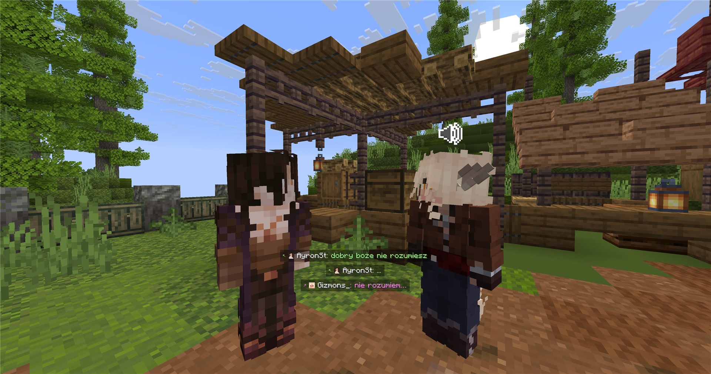
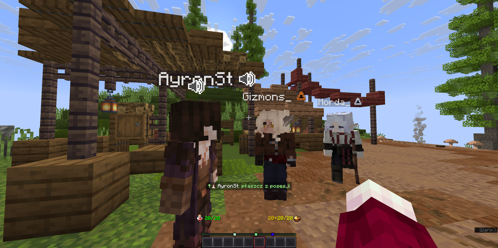
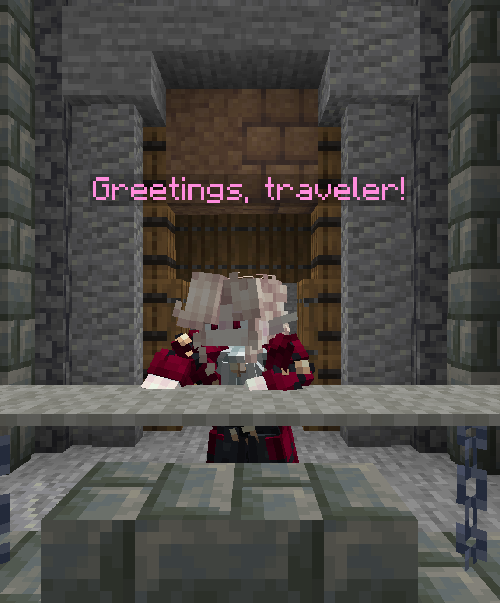
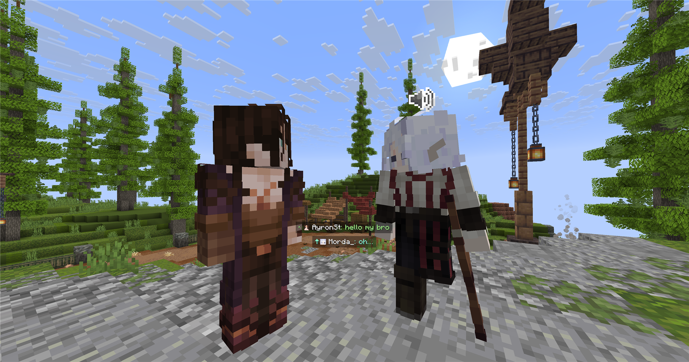
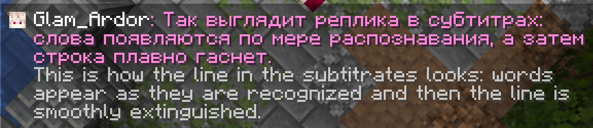

# Voice Subtitles

Live subtitles for [Simple Voice Chat](https://modrinth.com/plugin/simple-voice-chat): who is speaking, and what they are saying, in a caption feed along the bottom of the screen, or along the top if that suits your interface better.

**Voice chat leaves some players out.** If you are deaf or hard of hearing, proximity voice chat is a conversation happening around you that you cannot join – on roleplay servers, where most of the story is told out loud, that means missing the game itself. The same is true if you play with the sound off, in a noisy room, or in a language you read more easily than you hear. This mod puts that conversation on screen.

Everything runs on your own machine. Nothing is recorded, nothing is uploaded, and no server-side mod is needed.



## What it does

- **Caption feed** in the spirit of Minecraft: Story Mode – the speaker's head, their name, and their speech, stacked above the hotbar and fading out when the conversation moves on.
- **Roleplay names.** The name comes from the player list, so a character you know shows up as their character name and one you have not met shows up exactly as the server calls them.

  

- **Per-speaker colours,** derived from each player's UUID, so the same person is the same colour for everybody running the mod. Can be set to plain white, or assigned by hand.
- **Above the speaker's head** as an alternative to the feed, drawn independently of name tags so it works on servers that hide them.

  

- **Distance is visible, not filtered.** Everything the client can hear gets a caption; the further away and the quieter the voice, the fainter its text. Whispers are fainter still. Nothing is ever hidden for being far away.
- **Where the voice came from,** optionally: a small arrow in front of each line points at the speaker – up for ahead, down for behind you. Off by default.

  

- **Text chat too, if you want it** – voice only by default, or voice and chat together, or either one written to the log and drawn nowhere.
- **Translation,** for a server where not everybody speaks the same language. Russian and English, both ways, on your own machine. See below.

## Translation

A roleplay server is a story told out loud, and somebody who does not speak the language it is told in is standing outside it. This turns what they hear and what they read into their own language, and it does that without sending a word of it anywhere.

Mark whoever speaks something else and the mod does the rest:

```
/vsub lang Gizmons_ en
```

From then on that player's voice goes into an English model rather than a Russian one, and what it produces is translated under the original. Everybody else carries on through the model they always did. Text chat, `/me`, `/do`, `/try` and the rest are translated too, in place, under the line they belong to.



Four settings, and the difference between them is how much is loaded and when:

| | |
|---|---|
| **Off** | nothing. Everybody's voice goes into your own model, which is what a Russian model does to English speech: writes it out in Cyrillic, phonetically, and it reads as nonsense |
| **Recognise only** | a second recognition model for the people you marked, so at least their words come out in their own alphabet. Nothing is translated and no translation model is downloaded |
| **Automatic** | recognise and translate, loading both the moment one of those people is heard and letting go of them once they have been quiet for five minutes. For a server where they are the exception |
| **Always** | the same, loaded from the moment you join. For somebody who is the exception themselves and hears another language all evening |

The original is kept under the translation, so a name a translator mangled can still be read as it was said. Names in brackets and words the server put in brackets are held back from the translator entirely and put back afterwards, because a translated character name is a different character.

The translation runs through [OPUS-MT](https://github.com/Helsinki-NLP/Opus-MT) by the University of Helsinki, quantised to eight bits and run by ONNX Runtime: a hundred and thirteen megabytes per direction, a few hundred milliseconds per sentence, and no network at any point. Russian and English only for now, both ways.

## The conversation log

Scroll back through the evening, search it, and save what the filters are showing to a file.

- **Kept across restarts.** Written as you play, one file per day, held for a fortnight by default, on your disk and nowhere else.
- **Search and filters:** by text, by speaker, by voice or chat, by how far back, oldest or newest first.
- **The rest of the evening too:** joining a world or a server, deaths, commands as they were typed, the whole of the chat. Login and registration are never written down; they carry a password.
- **Sealed.** Each line is encrypted and carries the fingerprint of the one before it, so the file cannot be reworded in a text editor and any tampering is reported rather than shown as though genuine. The key sits on the same machine, so this is not proof of anything to anybody; it turns silent tampering into visible tampering.

Spoken lines come from the recogniser, so treat them as a reminder of the conversation rather than a transcript. Text chat lines are exact and marked as such.

## Speech recognition

Recognition runs entirely on your machine, through [sherpa-onnx](https://github.com/k2-fsa/sherpa-onnx) or [Vosk](https://alphacephei.com/vosk/), whichever the chosen model needs.

**This mod downloads what it needs after installation.** A recognition engine and a language model are both far too large to ship inside a 3 MB mod, so the first time one is needed the mod fetches it: the engine from the project's own GitHub releases, the model from there or from `alphacephei.com`, a translation model from Hugging Face. All of it lands in `config/voice_subtitles`. Those are the only network requests the mod ever makes. Nothing is uploaded, nothing is reported, and no audio ever leaves your machine.

The engine is executable code rather than data, so its archive is checked against a SHA-256 hash built into the mod before anything is unpacked or loaded, and refused if it does not match.

If you would rather it did not download anything: turn off **Download the model automatically** in the settings, and fetch what you want by hand with `/vsub model download <id>`. Without a model the mod still shows who is speaking, just without the words.

```
/vsub model list
/vsub model download ru-giga-rnnt
/vsub model use ru-giga-rnnt
```

### Two downloads of this mod

**`voice-subtitles-x.y.z.jar`** is the ordinary one: 3 MB, and it fetches the engine and the model the first time it needs them. Take this one.

**`voice-subtitles-x.y.z-full.jar`** is 177 MB and is the same mod with the recognition engine and the Russian GigaAM model already inside it. On the first run it copies them onto disk in about a second and never asks the network for anything.

It exists because for some people the download is the problem rather than the size. GitHub and Hugging Face are reached slowly from some places and not at all from others, and an evening spent watching a progress bar crawl is an evening not spent playing. If that is not you, the ordinary jar is smaller, covers every platform, and lets you pick a different model.

The full jar carries the engine built for **Windows x64** only, since six platform builds would be most of its weight. On anything else it still saves you the model and fetches the engine, which is 7 to 30 MB. Translation models are not in it either; they are a separate download in both jars.

### The models

Two kinds. **Streaming** models type the words out as they are spoken. **Whole-utterance** models look both ways through a sentence before deciding what a word was, which is where their accuracy comes from and why a line arrives a second or so after it was said; the mod re-reads the audio as it accumulates, so the caption still grows while somebody talks.

Russian:

| id | size | kind | notes |
|---|---|---|---|
| `ru-giga-rnnt` | 162 MB | whole utterance | **the default.** GigaAM v3 by Sber, the most accurate here, and it writes punctuation and capitals of its own accord |
| `ru-giga` | 156 MB | whole utterance | the same model in its CTC form: quicker to load, a little rougher on word endings |
| `ru-big` | 237 MB | whole utterance | the big Vosk model exported to ONNX: same lineage as `ru-large`, seconds to load instead of a minute |
| `ru-big-int8` | 57 MB | whole utterance | the same, quantised |
| `ru-tone` | 123 MB | streaming | T-one, trained on telephone speech; understands a compressed channel but drops word endings |
| `ru-stream` | 85 MB | streaming | the small Vosk model in ONNX form |
| `ru-fast` | 23 MB | streaming | the same, quantised: the lightest thing here |
| `ru` | 45 MB | streaming | Vosk, the original small model |
| `ru-large` | 1.8 GB | streaming | Vosk at its best, and a minute to load. `ru-big-int8` is the same accuracy for a fortieth of the size |

English:

| id | size | kind | notes |
|---|---|---|---|
| `en-fast` | 103 MB | whole utterance | **the default.** NVIDIA Parakeet, punctuation and capitals included, trained on the way people talk rather than on read-aloud books |
| `en-heavy` | 465 MB | whole utterance | Parakeet 0.6B: more accurate again, and in fact **25 European languages**, Russian and Ukrainian among them |
| `en` | 40 MB | streaming | Vosk, the original small model |
| `en-large` | 1.8 GB | streaming | Vosk at its best |

Other languages, all Vosk: `uk`, `de`, `fr`, `es`, `pl`, `it`, `ja`. For most of them `en-heavy` is worth trying instead, since it covers them too.

### How accurate, honestly

The small streaming models get roughly every third word wrong on spontaneous speech through a compressed voice channel. The gist reads fine; a word-for-word transcript it is not. Character names are the worst case: a model trained on ordinary speech has never seen "Элиандрэль фон Сильверхейм" and will never produce it.

The whole-utterance models are markedly better and cost a second of delay. That is the trade this mod defaults to, because a caption that is right and a moment late beats one that is instant and wrong.

## Commands

| Command | What it does |
|---|---|
| `/vsub lang <player> <ru\|en\|reset>` | Marks somebody as speaking another language, by UUID rather than by name: on a roleplay server a name is a costume and the person underneath goes on speaking the same language |
| `/vsub lang` | Everybody who has been marked, and what everyone else is taken to speak |
| `/vsub color <player> <#RRGGBB\|reset>` | Assigns a colour by hand |
| `/vsub model list\|download <id>\|use <id>\|status` | Manages recognition models |
| `/vsub model repair` | Throws away whatever took the game down last time and fetches it again |
| `/vsub log` | Opens the conversation log |
| `/vsub preview` | Puts a sample caption on screen, so their look can be set without waiting for somebody to talk |

## Settings

Mod Menu opens the settings screen: the richer Cloth Config version when Cloth is installed, the built-in one otherwise. Either way `config/voice_subtitles.json` is the source of truth.

Three keys are available under **Voice Subtitles** in the game's controls – turn subtitles on and off, switch between the feed and above the head, and open the conversation log. All three ship unbound: whatever key this mod could claim is a key somebody already uses.

## Alongside other mods

[Absolute Cinema Camera](https://codeberg.org/Glam_Ardor/absolute-cinema-camera) hides the whole interface for its film mode. Subtitles stay, sitting just on top of the bottom matte, because somebody reading the conversation instead of hearing it should not lose it to a camera angle. Nothing to install or switch on, and nothing changes if that mod is not there.

## Requirements

- Minecraft 1.21.6 – 1.21.8, Fabric
- Fabric API
- Simple Voice Chat

## Thanks

Thanks to **Contik** and **Gizmons_** for testing.

## Third-party components

The mod itself is about 3 MB. Everything heavy is fetched when it is first needed, or already sitting in the full jar.

Bundled inside the mod jar:

- [JNA](https://github.com/java-native-access/jna) – Apache License 2.0 / LGPL 2.1+
- [Apache Commons Compress](https://commons.apache.org/proper/commons-compress/) – Apache License 2.0
- The Java API of [ONNX Runtime](https://github.com/microsoft/onnxruntime) by Microsoft – MIT, without its native runtime: the copy sherpa-onnx puts on disk is the same library, so there is no sense carrying a second one
- The Java API of [sherpa-onnx](https://github.com/k2-fsa/sherpa-onnx) by Xiaomi Corporation – Apache License 2.0, copied from tag v1.13.4
- The Java API of [Vosk](https://github.com/alphacep/vosk-api) by Alpha Cephei Inc – Apache License 2.0, copied from tag v0.3.45

Downloaded on demand, and only what you use:

- The **recognition engine** for your platform: [sherpa-onnx](https://github.com/k2-fsa/sherpa-onnx) (7–30 MB) or [Vosk](https://github.com/alphacep/vosk-api) (25 MB), both Apache License 2.0. This is executable code rather than data, so the archive is checked against a SHA-256 hash built into the mod before it is unpacked or loaded, and refused if it does not match.
- The **model** you chose:
  - [GigaAM](https://github.com/salute-developers/GigaAM) by Sber – MIT
  - [Parakeet](https://huggingface.co/nvidia/parakeet-tdt-0.6b-v3) by NVIDIA – CC BY 4.0
  - [T-one](https://github.com/voicekit-team/T-one) by T-Bank – Apache License 2.0
  - [Vosk models](https://alphacephei.com/vosk/models) – Apache License 2.0
- The **translation model** for the direction you need: [OPUS-MT](https://github.com/Helsinki-NLP/Opus-MT) by the University of Helsinki, quantised to eight bits by [Xenova](https://huggingface.co/Xenova) – Apache License 2.0, 113 MB per direction

The full jar carries two of those already unpacked: the sherpa-onnx engine for Windows x64 and the GigaAM Russian model. Nothing about them is different, and it is the same code either way.

## Where things are kept

Everything lives under `config/voice_subtitles`:

| | |
|---|---|
| `models/` | the language models you downloaded |
| `translate/` | the translation models, one folder per direction |
| `native/` | the recognition engines |
| `history/` | the conversation log, one file per day |
| `logs/` | anything you saved from the log screen by hand |

The conversation log is written as you play so it survives closing the game, and kept for a fortnight by default. It never leaves your machine. Both the keeping and the keeping-for-how-long are settings, and emptying it from the log screen deletes the files too.

## Licence

LGPL-3.0-or-later
